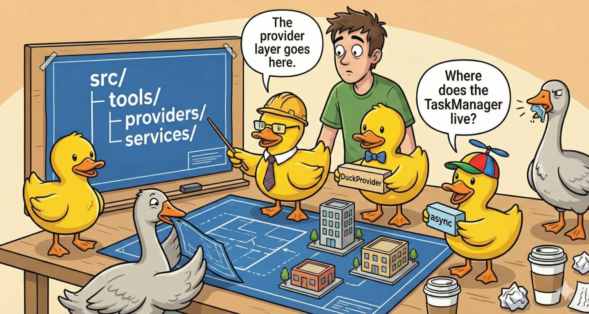

# Architecture

<p align="center">
  
</p>

```
mcp-rubber-duck/
├── src/
│   ├── server.ts           # MCP server implementation
│   ├── config/             # Configuration management
│   ├── data/               # Default pricing data
│   ├── guardrails/         # Safety & compliance plugins
│   ├── providers/          # Provider abstraction layer
│   │   ├── types.ts        # IDuckProvider interface
│   │   ├── provider.ts     # DuckProvider (HTTP/OpenAI SDK)
│   │   ├── manager.ts      # ProviderManager factory
│   │   └── cli/            # CLI subprocess providers
│   │       ├── cli-provider.ts   # CLIDuckProvider
│   │       ├── presets.ts        # Built-in CLI tool presets
│   │       ├── output-parsers.ts # Text/JSON/JSONL parsers
│   │       └── process-runner.ts # child_process.spawn wrapper
│   ├── tools/              # MCP tool implementations
│   ├── prompts/            # MCP prompt templates
│   ├── services/           # Health, conversations
│   ├── ui/                 # Interactive UI apps (MCP Apps)
│   └── utils/              # Logging, ASCII art
├── config/                 # Configuration examples
└── tests/                  # Test suites
```

## Tool Annotations

All tools include MCP-compliant annotations that describe their behavioral characteristics:

| Annotation | Meaning |
|------------|---------|
| `readOnlyHint` | Tool doesn't modify any state |
| `destructiveHint` | Tool performs irreversible operations |
| `idempotentHint` | Tool is safe to retry multiple times |
| `openWorldHint` | Tool accesses external systems (APIs, network) |

These help MCP clients make informed decisions about tool execution and user confirmations.

## Async Task Support

Long-running tools (`duck_iterate`, `duck_debate`) implement the `io.modelcontextprotocol/tasks` extension (SEP-2663) by hand on top of SDK v2. When a 2026-07-28 request declares the extension, `tools/call` returns a CreateTaskResult right away and the work continues in the background; clients poll with `tasks/get`, and `tasks/update` / `tasks/cancel` operate on the task. Every other client (2025-11-25, or 2026-07-28 without the extension) gets the synchronous result.

- **Progress reporting** -- All multi-provider tools (`compare_ducks`, `duck_council`, `duck_vote`, `duck_debate`, `duck_iterate`) emit `notifications/progress` as each provider responds. In task mode, progress surfaces as the task's `statusMessage` and `lastUpdatedAt` instead.
- **Cancellation** -- `tasks/cancel` aborts the task's `AbortSignal`, which reaches the in-flight provider request.
- **Task lifecycle** -- Managed by `TaskManager` (`src/services/task-manager.ts`) over the SDK-free `RetentionTaskStore` (`src/services/retention-task-store.ts`): process-scoped (shared by every per-connection or per-request server instance), with a retention window that only starts once a task finishes.

## Transports and protocol eras

`RubberDuckServer` (`src/server.ts`) builds its services once per process (config, providers, conversations, health, MCP Bridge) and hands a cheap `buildMcpServer()` factory to the transport:

- **stdio** (default) -- `serveStdio(factory)` classifies the first message of each connection as 2026-07-28 (`server/discover` + per-request `_meta` envelope) or 2025-11-25 (`initialize`) and pins one server instance per connection.
- **Streamable HTTP** (`MCP_TRANSPORT=http`) -- `src/transport/http.ts` mounts `createMcpHandler(factory, { legacy: 'stateless' })` on `node:http`, building a server per request. Requests pass a constant-time bearer check, then Host and Origin validation; a non-loopback bind without `MCP_HTTP_TOKEN` refuses to start.
